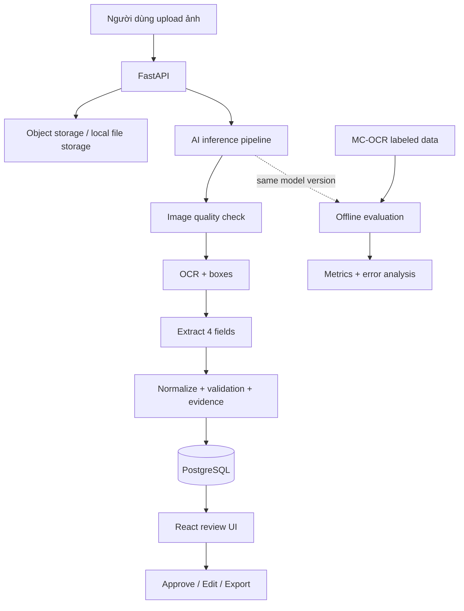

# VietDocAI — Vietnamese Receipt Intelligence Platform

> **Tài liệu triển khai dự án theo Phase (MVP → Production Demo → Nâng cao)**  
> Phiên bản: 2.0 · Cập nhật: 12/10/2026  
> Phạm vi dữ liệu chính: **MC-OCR 2021** · Hướng ứng tuyển: **AI Engineer Intern/Fresher**

---

## 0. Tóm tắt dự án

**VietDocAI** là ứng dụng đọc hiểu **ảnh chụp hóa đơn/biên lai bán lẻ tiếng Việt**. Người dùng tải ảnh lên; hệ thống đánh giá chất lượng ảnh, nhận diện văn bản, trích xuất các thông tin cốt lõi, cho phép kiểm tra/sửa lại và lưu/xuất kết quả.

### 0.1. Phạm vi chính thức

**Chỉ tập trung vào MC-OCR 2021** và bốn trường key information extraction (KIE):

| Trường chuẩn hóa trong app | Ý nghĩa | Ví dụ minh họa |
|---|---|---|
| `seller` | Tên người bán/cửa hàng | `Siêu thị ABC` |
| `seller_address` | Địa chỉ người bán | `12 Nguyễn Trãi, Hà Nội` |
| `timestamp` | Ngày/giờ hóa đơn | `2026-10-08T09:26:00` |
| `total_cost` | Tổng số tiền cần thanh toán | `150000` |

> Tên và định dạng nhãn **gốc** cần được đối chiếu với `label_dict.json` và dữ liệu tải về. Không mặc định nhãn xuất hiện ở tất cả ảnh; field thiếu/không đọc được được biểu diễn bằng `null`, không suy đoán.

**Trong phạm vi:**

- Nhận ảnh JPG/PNG (và tùy chọn PDF 1 trang nếu thật sự cần).
- Kiểm tra chất lượng đầu vào, xoay ảnh khi cần.
- OCR văn bản và tọa độ vùng chữ.
- Trích xuất bốn trường đã định nghĩa.
- Chuẩn hóa kết quả và đối chiếu bằng chứng trên ảnh.
- Giao diện người dùng kiểm tra/chỉnh sửa (*human-in-the-loop*).
- Lưu dữ liệu; lịch sử xử lý; tìm kiếm đơn giản; xuất JSON/CSV/Excel.
- Đánh giá offline với annotation MC-OCR và so sánh ít nhất hai phương pháp.
- Đóng gói bằng Docker và triển khai một bản demo.

**Ngoài phạm vi (không làm trong MVP):**

- DocILE; trích xuất đầy đủ mọi dòng hàng, VAT chi tiết.
- Purchase Order, Goods Receipt, Three-way Matching.
- RAG, Qdrant, embedding, reranking, chatbot tài liệu.
- Fine-tune VLM lớn, Kubernetes, microservices phức tạp.
- Tự động hạch toán hay phê duyệt nghiệp vụ tài chính.

### 0.2. Kết quả mong đợi

Một demo có thể thực hiện kịch bản: **Upload → OCR/KIE → Hiển thị ảnh & bốn trường → Highlight evidence → Sửa/duyệt → Lưu → Export**; đồng thời có **báo cáo benchmark tái lập được**. Kết quả đo thực tế phải do bạn chạy, tuyệt đối không bịa số liệu.

### 0.3. Hai workflow độc lập nhưng dùng chung AI core

- **Online app:** xử lý ảnh người dùng upload và lưu kết quả.
- **Offline evaluation:** chạy mô hình trên bộ test có ground truth để đánh giá; không dùng dữ liệu người dùng thật làm ground truth mặc định.



---

## 1. Công nghệ & nguyên tắc kiến trúc

| Tầng | Khuyến nghị MVP | Vì sao |
|---|---|---|
| Frontend | React + Ant Design | Upload, hiển thị ảnh, sửa field, trang lịch sử |
| Backend | Python + FastAPI | Cùng hệ sinh thái Python với AI; API dễ test |
| OCR | PaddleOCR pretrained | Trích xuất văn bản + box nhanh để xây baseline |
| KIE baseline | Rules/heuristics dựa trên OCR spans | Đơn giản, diễn giải được, đo tốc độ thấp |
| KIE nâng cao | OCR + LLM hoặc VLM phù hợp | Để benchmark; **không bắt buộc** cho MVP |
| Validation | Pydantic + hàm chuẩn hóa | JSON schema và kiểm tra dữ liệu |
| DB | PostgreSQL | Lưu tài liệu, extraction, correction, job |
| File storage | Local folder cho dev; S3-compatible khi deploy | Tránh lưu binary trong DB |
| Tests | pytest | Unit/API/e2e tests |
| Đóng gói | Docker Compose | Chạy backend/frontend/db đồng bộ |
| Monitoring | Structured logging + latency | Đủ cho demo; không cần stack phức tạp |

**Nguyên tắc:**

1. Xây **baseline trước**, không vội fine-tune.
2. API giao tiếp qua schema thống nhất; model OCR/KIE có thể thay thế độc lập.
3. Tiền xử lý ảnh có thể gây mất chữ — mọi thay đổi cần kiểm tra bằng validation set.
4. Evidence phải liên kết với vị trí OCR thật; **không để LLM tự bịa bounding box**.
5. **Train/validation/test tách biệt**; chỉ báo cáo test sau khi chốt pipeline.
6. Dữ liệu MC-OCR có điều kiện sử dụng nghiên cứu; **không public lại ảnh/nhãn** khi chưa được phép.
7. Chỉ triển khai cloud nếu đã kiểm tra quyền gửi ảnh/chứng từ tới nhà cung cấp dịch vụ.

### 1.1. Cấu trúc repo đích

```text
vietdocai/
├── frontend/
│   └── src/
│       ├── pages/             # Upload, Review, History, Dashboard
│       ├── components/        # Image viewer, field editor, badges
│       └── api/
├── backend/
│   ├── app/
│   │   ├── main.py
│   │   ├── api/               # routes: documents, jobs, reviews, exports
│   │   ├── models/            # ORM
│   │   ├── schemas/           # Pydantic
│   │   ├── services/
│   │   └── core/
│   └── tests/
├── ai/
│   ├── preprocessing/
│   ├── quality/
│   ├── ocr/
│   ├── kie/
│   ├── normalization/
│   ├── schemas.py
│   └── pipeline.py
├── evaluation/
│   ├── dataset_adapter.py
│   ├── metrics.py
│   ├── run_benchmark.py
│   ├── error_analysis.py
│   └── reports/
├── tests/                   # integration/e2e
├── scripts/
├── configs/
├── docs/
├── data/                    # không commit dữ liệu gốc
│   ├── raw/
│   ├── splits/
│   └── samples_synthetic/
├── docker-compose.yml
├── .env.example
├── .gitignore
├── README.md
└── pyproject.toml           # hoặc requirements*.txt
```

---

## 2. Kế hoạch Phase tổng quan

Thời lượng là **ước lượng cho một người làm bán thời gian**, không phải deadline bắt buộc. Thời gian thực tế phụ thuộc dữ liệu, GPU và kinh nghiệm triển khai.

| Phase | Tên | Dự kiến | Đầu ra bắt buộc |
|---|---|---:|---|
| **0** | Scope & Project Setup | 2–3 ngày | Repo, cấu hình, schema, plan |
| **1** | MC-OCR Dataset & Evaluation Protocol | 4–6 ngày | Dataset adapter, splits, EDA |
| **2** | OCR + Image Quality Baseline | 5–7 ngày | OCR spans/boxes, quality module |
| **3** | Key Information Extraction | 7–10 ngày | JSON 4 field + evidence |
| **4** | Benchmark & Model Selection | 4–6 ngày | Metrics + so sánh + error analysis |
| **5** | Backend & Persistence | 5–7 ngày | REST API + PostgreSQL |
| **6** | Frontend & Human Review | 5–8 ngày | App chạy end-to-end |
| **7** | Testing, Deployment & Portfolio | 5–8 ngày | Docker, live demo, README, video |
| **8 (optional)** | Advanced AI & Product Improvements | sau MVP | Kết quả tối ưu hóa đo được |

**Điểm cắt MVP:** Hoàn thành **Phase 0 → 6**.  
**Điểm cắt portfolio ứng tuyển:** Hoàn thành **Phase 0 → 7** + benchmark tái lập.  
**Nâng cao:** Phase 8 chỉ thực hiện khi MVP ổn định.

---

## PHASE 0 — Xác định phạm vi & khởi tạo dự án

**Mục tiêu:** Khoanh scope cố định để tránh phát sinh các tính năng không phục vụ bài toán.

### Công việc

- [ ] Khởi tạo repo GitHub `vietdocai` và README tóm tắt bài toán.
- [ ] Tạo cây thư mục theo kiến trúc ở trên; không cần code tất cả module ngay.
- [ ] Tạo môi trường Python riêng và thống nhất version; kiểm tra PaddleOCR chạy với hệ điều hành/GPU đang có.
- [ ] Khởi tạo React app, FastAPI app và endpoint `GET /health`.
- [ ] Định nghĩa schema `ReceiptExtraction` cho 4 fields (`seller`, `seller_address`, `timestamp`, `total_cost`).
- [ ] Định nghĩa schema `Evidence` gồm `page`, `bbox`, `text`, `source_id` (nếu có).
- [ ] Quy định các trạng thái tài liệu: `uploaded`, `processing`, `needs_review`, `ready`, `approved`, `failed`.
- [ ] Thiết lập `.gitignore` cho dataset, `.env`, file ảnh upload và model weights khi cần.
- [ ] Viết 3 user stories: upload ảnh, kiểm tra/chỉnh sửa, xem lịch sử/export.

### Output

- `README.md` bản đầu; `docs/requirements.md`.
- `ai/schemas.py`, `backend/app/main.py`, frontend skeleton.
- Repo chạy được frontend/backend với dữ liệu mock.

### Definition of Done (DoD)

- [ ] `GET /health` trả 200; giao diện mở được.
- [ ] Có JSON schema hợp lệ cho kết quả trích xuất, cho phép trường thiếu là `null`.
- [ ] Repo không chứa token, mật khẩu, ảnh gốc hay dữ liệu có điều kiện cấp phép.

---

## PHASE 1 — Chuẩn bị MC-OCR & quy trình đánh giá

**Mục tiêu:** Hiểu chính xác annotation và cố định phương pháp chia dữ liệu trước khi chọn model.

### Công việc

- [ ] Đọc trang dataset/challenge chính thức và quy định truy cập; đăng ký/ký thỏa thuận nếu được yêu cầu.
- [ ] Tải **phần dữ liệu có nhãn được phép dùng**. Không giả định toàn bộ ảnh test công khai đều có ground truth.
- [ ] Kiểm tra tệp ảnh, CSV/JSON, `label_dict.json`, chất lượng ảnh và các field có sẵn.
- [ ] Viết `evaluation/dataset_adapter.py` để chuyển nhãn gốc sang schema chuẩn hóa.
- [ ] Quy định rõ: field không có trong ảnh/không đọc được → `null`; khác với lỗi dự đoán.
- [ ] Thực hiện EDA: số ảnh, độ phân giải, tỷ lệ từng field xuất hiện, độ dài chuỗi, lỗi/nhãn thiếu, nhóm mẫu hóa đơn.
- [ ] Phát hiện ảnh trùng hoặc gần trùng; chia theo mẫu/nhà bán nếu có thể, nhằm giảm data leakage.
- [ ] Chia phần có nhãn thành **train/dev/test nội bộ** (ví dụ 70/15/15), lưu manifest có seed và SHA-256. Không dùng test để chỉnh prompt/hyperparameter.
- [ ] Tạo `evaluation/data_contract.md` mô tả annotation, data split, normalize text và metric.
- [ ] Tạo tập 10–20 ảnh đã được phép dùng để **smoke test cục bộ** (không commit nếu license hạn chế).

### Lưu ý về MC-OCR

MC-OCR gồm hai nhiệm vụ gốc: **Receipt Image Quality Assessment** (điểm chất lượng từ 0 đến 1 dựa trên tỷ lệ dòng văn bản rõ) và **Key Information Extraction** (tối đa bốn thông tin: seller, seller address, timestamp, total cost). Cần phân biệt điểm IQA gốc với một bộ phân loại ảnh mờ/tốt do bạn tự thiết kế.

Số lượng và cấu trúc thực tế phải xác nhận từ gói tải hợp lệ. Theo bài báo gốc, Public Training có **1.155 ảnh**; các split của cuộc thi khác với split nội bộ bạn tự tạo.

### Output

- `evaluation/dataset_adapter.py`.
- `data/splits/train.json`, `dev.json`, `test.json` (manifest ID/path, không chứa ảnh nếu không được phép).
- `docs/dataset_eda.md` và `evaluation/data_contract.md`.

### DoD

- [ ] Adapter đọc được nhãn, ảnh và metadata của toàn bộ split được phép sử dụng.
- [ ] Tách train/dev/test tái lập cùng seed, không trùng file.
- [ ] Có ít nhất 10 record kiểm thử annotation thủ công.
- [ ] Đã lưu các quy định dùng dữ liệu vào `docs/data_usage.md`.

---

## PHASE 2 — OCR Baseline & Image Quality

**Mục tiêu:** Nhận diện dòng chữ cùng tọa độ; kiểm tra chất lượng ảnh đầu vào.

### Công việc

- [ ] Xây `ai/preprocessing/`: đọc ảnh, kiểm tra orientation, đổi kích thước có giữ tỷ lệ; chỉ deskew/denoise khi cần.
- [ ] Chạy PaddleOCR pretrained trên tập dev, lưu `text`, `confidence` (nếu model hỗ trợ), `polygon/bbox` cho từng vùng.
- [ ] Định nghĩa interface `OCRProvider.predict(image) -> list[OCRSpan]`.
- [ ] Quy đổi tọa độ về **ảnh gốc** để UI highlight chính xác sau resize/rotate.
- [ ] Xây module image quality: bắt đầu với phép đo đơn giản/heuristic, sau đó so sánh một model học máy nếu cần.
- [ ] Nếu dự đoán **điểm IQA gốc**, dùng đúng nhãn chất lượng 0–1 để đánh giá; đừng gọi threshold tự đặt là nhãn chính thức.
- [ ] Thêm xử lý ảnh lỗi, ảnh quá nhỏ, xoay sai, không tìm được text.
- [ ] Log thời gian OCR/ảnh và lưu các mẫu lỗi để phân tích.

### Output

Ví dụ interface OCR nội bộ:

```json
{
  "image_width": 768,
  "image_height": 1024,
  "spans": [
    {
      "id": "span_01",
      "text": "TỔNG THANH TOÁN: 150.000",
      "bbox": [300, 800, 650, 840],
      "confidence": 0.91
    }
  ]
}
```

> Đây là schema **nội bộ minh họa**, không phải định dạng trả về nguyên bản của PaddleOCR.

### DoD

- [ ] Module OCR trả text + boxes nhất quán cho ảnh mẫu.
- [ ] Tọa độ box được hiển thị đúng trên ảnh gốc.
- [ ] Chạy được batch inference trên tập dev và ghi lại thời gian xử lý.
- [ ] Chất lượng ảnh được đánh giá/ghi nhận; không chặn cứng chỉ theo threshold chưa kiểm chứng.

---

## PHASE 3 — Trích xuất 4 trường thông tin (KIE)

**Mục tiêu:** Biến output OCR thành JSON có ý nghĩa nghiệp vụ và bằng chứng nguồn.

### Công việc

**3A. Baseline dễ giải thích**

- [ ] Tạo `ai/kie/rule_based.py`: chọn seller/address theo keyword, vị trí và quan hệ vùng văn bản.
- [ ] Tạo parser ngày/giờ tiếng Việt, nhiều định dạng đầu vào; trả `null` nếu không chắc chắn.
- [ ] Tạo parser tiền tệ VND (`150.000`, `150,000`, `150 000`...) và chống nhầm số điện thoại/mã giao dịch với tổng tiền.
- [ ] Xử lý biên lai thiếu một hoặc nhiều trường, OCR trả nhiều dòng trùng nghĩa.

**3B. Phương pháp nâng cao để so sánh (chọn MỘT trước)**

- [ ] **Lựa chọn 1:** OCR + LLM trả JSON theo schema.
- [ ] **Lựa chọn 2:** VLM trực tiếp từ ảnh trả JSON.
- [ ] Nếu dùng API ngoài: bảo vệ dữ liệu, không gửi ảnh thực tế trái điều khoản, ghi nhận chi phí/latency.
- [ ] So sánh bằng cùng bộ dev; không bắt buộc dùng LLM/VLM để app chạy.

**3C. Chuẩn hóa & evidence**

- [ ] Tạo `ReceiptExtraction` với bốn field, dạng raw và normalized.
- [ ] Với từng field, đính kèm `span_ids` và vùng box thật khi matching được.
- [ ] Trường không tìm thấy = `null`; không ép mô hình điền bừa.
- [ ] Kiểm tra timestamp, kiểu dữ liệu tiền, format JSON, range hợp lý.
- [ ] Thêm `warnings` khi thông tin mâu thuẫn/thiếu hoặc confidence không đủ.
- [ ] Viết unit tests cho parser ngày giờ, tổng tiền, Unicode, dấu phân tách.

### Output JSON tiêu chuẩn

```json
{
  "document_type": "receipt",
  "model_version": "baseline-v1",
  "fields": {
    "seller": "Cửa hàng ABC",
    "seller_address": "12 Nguyễn Trãi, Hà Nội",
    "timestamp": "2026-10-08T09:26:00",
    "total_cost": 150000
  },
  "evidence": {
    "total_cost": {
      "span_ids": ["span_01"],
      "bbox": [300, 800, 650, 840]
    }
  },
  "warnings": []
}
```

### DoD

- [ ] Cùng một ảnh luôn trả JSON hợp schema; không văng lỗi khi field thiếu.
- [ ] Có thể truy ngược ít nhất các field tìm được về OCR span tương ứng.
- [ ] Có 2 pipeline KIE chạy được trên cùng input để benchmark (rules và một candidate khác).
- [ ] Có unit tests cho parsing và normalize.

---

## PHASE 4 — Evaluation, Benchmark & Error Analysis

**Mục tiêu:** Có **bằng chứng kỹ thuật** về hiệu quả của pipeline trước khi làm full-stack.

### Công việc

- [ ] Xây script `python -m evaluation.run_benchmark --split dev --model baseline` (định nghĩa CLI tương ứng).
- [ ] Tạo hàm normalize GT và prediction thống nhất; không normalize quá mức làm mất ý nghĩa.
- [ ] Đo **Exact Match** cho seller/address/timestamp/total, có thêm mức chuẩn hóa riêng cho ngày/tiền.
- [ ] Đo **CER** cho text OCR nếu bộ nhãn dòng text tương thích; báo rõ đang đo OCR toàn văn hay text của KIE.
- [ ] Đo **Field Precision/Recall/F1** theo quy tắc match có tài liệu hóa; ghi rõ cách xử lý field missing.
- [ ] Nếu huấn luyện/đánh giá IQA score: đo MAE/RMSE theo score ground truth.
- [ ] Đo `latency_ms` cho OCR, KIE và toàn pipeline (P50/P95 khi đủ mẫu).
- [ ] So sánh ít nhất baseline rule-based và một phương pháp khác trên **cùng tập dev**.
- [ ] Phân nhóm lỗi: ảnh mờ, xoay, background phức tạp, OCR sai, seller sai, tổng tiền nhầm, date parsing sai.
- [ ] Chốt phương án cho app; chạy **held-out test một lần sau khi lựa chọn** và ghi rõ version/config.

### Mẫu bảng kết quả (để trống, điền bằng số thực tế)

| Method | Seller EM | Address EM | Date EM | Total EM | Overall field F1 | P95 latency |
|---|---:|---:|---:|---:|---:|---:|
| OCR + Rules | TBD | TBD | TBD | TBD | TBD | TBD |
| OCR + LLM **hoặc** VLM | TBD | TBD | TBD | TBD | TBD | TBD |

*Không phải mọi metric đều là metric chính thức của cuộc thi. Khi báo cáo phải giải thích đầy đủ cách tính; không so sánh trực tiếp số của mình với leaderboard nếu protocol khác nhau.*

### Output

- `evaluation/reports/baseline_dev.md`.
- `evaluation/reports/model_comparison.md`.
- `evaluation/reports/final_test.md` (chỉ khi chốt pipeline).
- `docs/error_analysis.md` với ví dụ sai và nguyên nhân.

### DoD

- [ ] Một lệnh chạy ra report, config/model version và số mẫu.
- [ ] Có ít nhất 2 phương pháp được so sánh công bằng.
- [ ] Không dùng held-out test để tinh chỉnh vòng lặp.
- [ ] Đưa ra quyết định chọn pipeline có căn cứ accuracy **và** latency/cost.

---

## PHASE 5 — FastAPI Backend & PostgreSQL

**Mục tiêu:** Biến model inference thành dịch vụ có trạng thái và lưu trữ.

### Công việc

- [ ] Tạo các bảng `users` (tùy chọn nếu app một tài khoản), `documents`, `extractions`, `field_corrections`, `processing_jobs` (nếu chạy async).
- [ ] Định nghĩa quan hệ: document → extraction(s) → corrections.
- [ ] `POST /api/v1/documents`: validate và upload ảnh; giới hạn kích thước, định dạng, số lần upload.
- [ ] `POST /api/v1/documents/{id}/process`: chạy pipeline; với ảnh đơn nhanh có thể xử lý đồng bộ lúc đầu.
- [ ] `GET /api/v1/documents/{id}`: metadata, trạng thái, kết quả và evidence.
- [ ] `PATCH /api/v1/documents/{id}/fields`: sửa field, lưu giá trị cũ/mới; chạy validation lại.
- [ ] `POST /api/v1/documents/{id}/approve`: duyệt thủ công.
- [ ] `GET /api/v1/documents`: danh sách, lọc ngày, seller, status, phân trang.
- [ ] `GET /api/v1/documents/{id}/export`: JSON/CSV; Excel tùy chọn.
- [ ] Bổ sung request validation, error handler, logging, `request_id`, auth cơ bản nếu đưa lên internet.
- [ ] Viết API tests; test ảnh không hợp lệ, file quá lớn, lỗi inference, trường bị null.

### Đề xuất schema database tối giản

```text
DOCUMENTS(
  id, storage_key, original_name, status,
  sha256, created_at, updated_at
)
EXTRACTIONS(
  id, document_id, model_version, raw_json,
  normalized_json, processing_time_ms, created_at
)
FIELD_CORRECTIONS(
  id, document_id, field_name, old_value,
  new_value, reviewer_id, created_at
)
```

> Dùng `JSONB` cho kết quả linh hoạt và thêm index khi đã biết nhu cầu truy vấn. Không lưu file binary vào PostgreSQL.

### DoD

- [ ] Upload ảnh → xử lý → lấy kết quả qua API thành công.
- [ ] Kết quả được lưu và truy vấn lại sau khi restart backend.
- [ ] Sửa field/approve có lịch sử thao tác.
- [ ] Có API tests cho luồng chính và luồng lỗi.

---

## PHASE 6 — React Frontend & Human-in-the-Loop

**Mục tiêu:** Hoàn thiện một ứng dụng end-to-end có thể cho nhà tuyển dụng trải nghiệm.

### Trang giao diện

1. **Upload:** kéo thả ảnh, preview, nút xử lý, trạng thái loading/lỗi.
2. **Review:** viewer hiển thị hóa đơn bên trái; bốn field bên phải.
3. **History:** danh sách ảnh đã xử lý, tình trạng, seller, ngày, tổng tiền.
4. **Dashboard nhỏ (tùy chọn):** số ảnh đã xử lý, số cần review, tổng tiền từ các bản ghi **đã duyệt**.

### Công việc

- [ ] Làm upload và preview.
- [ ] Render ảnh có overlay các `bbox` từ OCR; click field → highlight bằng chứng tương ứng.
- [ ] Hiển thị raw value/normalized value, cảnh báo field thiếu/không chắc chắn.
- [ ] Cho phép sửa `seller`, `seller_address`, `timestamp`, `total_cost`.
- [ ] Tạo `Save Correction` và `Approve` (khác nhau về ngữ nghĩa).
- [ ] Xem history theo status và tìm kiếm/lọc cơ bản.
- [ ] Cho phép export JSON/CSV từ bản ghi đã duyệt.
- [ ] Trạng thái lỗi rõ ràng khi ảnh không đọc được hoặc inference thất bại.
- [ ] Test browser bằng các ảnh demo **được phép sử dụng**.

### Tiêu chí UX

- Một ảnh thông thường được xử lý bằng một quy trình dễ hiểu, không yêu cầu người dùng thao tác dòng lệnh.
- Người dùng biết trường nào do AI sinh ra, trường nào đã được con người sửa.
- Không khẳng định một field là chính xác chỉ vì model tự trả confidence cao.

### DoD — **MVP hoàn chỉnh**

- [ ] Có thể demo toàn bộ: **Upload → AI → Review → Edit → Approve → History → Export**.
- [ ] Bounding boxes bám đúng vị trí khi co giãn ảnh trên trình duyệt.
- [ ] App xử lý được lỗi upload, ảnh không có text và field thiếu mà không sập.
- [ ] Giao diện có vài ảnh demo được cấp phép hoặc ảnh tự tạo.

---

## PHASE 7 — Integration Test, Docker, Deployment & Portfolio

**Mục tiêu:** Đưa dự án từ chạy trên máy phát triển thành sản phẩm có thể kiểm chứng.

### Công việc

- [ ] Viết integration test cho API + model mock; e2e test cho luồng upload/review/export.
- [ ] Dockerize backend và frontend; PostgreSQL local bằng Docker Compose.
- [ ] Có `docker compose up --build` để khởi chạy (thêm volumes/env hợp lý).
- [ ] Ghi version model, requirements và cách tải trọng số; không commit file nặng trái license.
- [ ] Đưa lên server/cloud nếu đủ tài nguyên; nếu không, cung cấp Docker local demo + video.
- [ ] Thêm auth khi triển khai công khai; tránh để mọi người đọc tài liệu upload của người khác.
- [ ] Giới hạn upload, kiểm tra MIME/magic bytes, chống path traversal; tách nơi lưu file khỏi thư mục public tùy tiện.
- [ ] Nếu inference chậm, bổ sung background job (`Redis/Celery`) **sau khi** đo được nhu cầu thực tế.
- [ ] Viết README bằng tiếng Anh hoặc song ngữ: Problem, Architecture, Features, Quick Start, Benchmark, Limitations.
- [ ] Viết architecture diagram, API docs, data/evaluation protocol, error analysis.
- [ ] Quay video demo 2–3 phút: upload → fields/evidence → sửa → export → bảng benchmark.
- [ ] Viết 1–2 CV bullets **chỉ dùng số đo thật**.

### Deliverables portfolio

- GitHub có source rõ ràng và hướng dẫn chạy.
- Demo URL (nếu có) **hoặc** hướng dẫn Docker + video.
- `docs/architecture.md`, `docs/evaluation.md`, `docs/limitations.md`.
- Bảng benchmark đầy đủ model, split, metric, cấu hình và thời gian xử lý.
- Tối thiểu một ví dụ thành công và một ví dụ thất bại có giải thích.

### DoD — **Sẵn sàng đưa vào CV**

- [ ] Một người khác có thể chạy dự án theo README, không cần hỏi tác giả từng bước.
- [ ] Benchmark có thể tái lập trên dữ liệu mà người đó được phép truy cập.
- [ ] Không lộ secret và không chia sẻ dataset MC-OCR trái điều khoản.
- [ ] App có demo/video hoàn chỉnh và mô tả giới hạn rõ ràng.

---

## PHASE 8 — Nâng cao (OPTIONAL: làm sau khi có MVP)

Chọn **một hoặc hai** hướng dựa trên error analysis, không làm tất cả.

### Option A — Cải thiện độ chính xác có chứng cứ

- [ ] Chọn nhóm lỗi lớn nhất: OCR mờ, seller/location, total/date.
- [ ] Áp dụng cải tiến cụ thể: rule, data augmentation train-only, fine-tune thành phần KIE/OCR phù hợp.
- [ ] Làm ablation: trước/sau cải tiến trên cùng dev; báo cáo test cuối phù hợp.
- [ ] Đo cải thiện F1/EM và chi phí đi kèm.

### Option B — Image Quality Gate thông minh

- [ ] Train/calibrate model IQA đúng nhãn 0–1 (nếu dữ liệu đáp ứng).
- [ ] Đề xuất chụp lại khi ảnh không đạt chất lượng; không tự động loại mọi ảnh chỉ vì score thấp.
- [ ] Đo tỷ lệ ảnh lỗi được phát hiện và số ảnh tốt bị cảnh báo nhầm.

### Option C — Batch Processing & Observability

- [ ] Nhận nhiều ảnh và xử lý qua Celery/Redis.
- [ ] Queue, retry, timeout, idempotency, job status.
- [ ] Đo throughput, P50/P95, failure rate; viết performance report.

### Option D — Human Review Analytics

- [ ] Lưu chỉnh sửa đã được người dùng đồng ý để phục vụ đánh giá.
- [ ] Đo tỷ lệ correction theo field và theo nhóm chất lượng ảnh.
- [ ] Xây cơ chế gom **dữ liệu được phép sử dụng** để cải thiện model sau này.

---

## 3. Hợp đồng kỹ thuật (interfaces) phải giữ nhất quán

### OCR

```python
class OCRProvider:
    def predict(self, image) -> list[dict]:
        """Trả các OCRSpan với text và box gắn với ảnh gốc."""
        raise NotImplementedError
```

### KIE

```python
class KIEProvider:
    def extract(self, image, ocr_spans: list[dict]) -> dict:
        """Trả ReceiptExtraction theo schema nội bộ."""
        raise NotImplementedError
```

### Evaluation

```python
def evaluate(predictions: list[dict], ground_truth: list[dict]) -> dict:
    """Trả metric per-field và metric tổng theo protocol đã định nghĩa."""
    raise NotImplementedError
```

> Đây là skeleton định hướng interface, chưa phải đoạn code chạy hoàn chỉnh.

---

## 4. Checklist end-to-end để demo

- [ ] Người dùng upload `receipt.jpg`.
- [ ] Backend kiểm tra loại file và lưu an toàn.
- [ ] AI module trả OCR spans.
- [ ] KIE trả bốn trường theo JSON schema.
- [ ] UI hiển thị ảnh + vùng bằng chứng tương ứng.
- [ ] Nếu thiếu/sai, người dùng sửa field và lưu correction.
- [ ] Người dùng duyệt; trạng thái đổi sang `approved`.
- [ ] Bản ghi xuất JSON/CSV đúng với kết quả đã duyệt.
- [ ] Khi lỗi inference, UI trả lỗi rõ ràng và vẫn truy cập lịch sử được.
- [ ] Báo cáo offline cho biết kết quả benchmark của chính phiên bản AI đó.

---

## 5. Mẫu báo cáo Phase để tự quản lý tiến độ

Sao chép mẫu sau vào `docs/progress/phase_N.md` sau mỗi Phase.

```markdown
# Phase N — [Tên phase]

- Start date:
- End date:
- Status: Not started / In progress / Blocked / Done

## Objectives
- ...

## Work completed
- [x] ...

## Technical decisions
- Decision:
- Alternatives considered:
- Reason:

## Evidence
- Commit / PR:
- Screenshot / API response:
- Experiment report:

## Known limitations
- ...

## DoD verification
- [ ] ...

## Next phase
- ...
```

---

## 6. Kết quả ghi CV (template, không điền số ảo)

**Project:** *VietDocAI — Vietnamese Receipt Intelligence Platform*  
**Tech stack:** Python, PaddleOCR, FastAPI, React, PostgreSQL, Docker, Pydantic.

> Developed an end-to-end Vietnamese receipt processing application with OCR, structured extraction, evidence-based human review, and REST APIs. Evaluated multiple extraction pipelines on MC-OCR data using field-level accuracy, error analysis, and latency benchmarks.

Sau khi có số đo thực nghiệm, bổ sung vào bullet thứ hai: số ảnh được đánh giá, phương pháp baseline, metric và độ trễ thực tế. Không ghi *fine-tuned* nếu thực tế chỉ dùng pretrained model.

---

## 7. Rủi ro & cách xử lý

| Rủi ro | Cách xử lý |
|---|---|
| Dataset không có đủ nhãn test công khai | Chỉ dùng phần có nhãn hợp lệ để tạo held-out set; ghi rõ protocol |
| MC-OCR có giới hạn mục đích nghiên cứu | Kiểm tra giấy phép trước khi public ảnh/demo; dùng ảnh tự tạo có quyền sử dụng để demo |
| OCR tốt nhưng KIE kém | Phân tách metric OCR và field extraction, phân loại lỗi |
| VLM chậm hoặc cần GPU | Giữ PaddleOCR + Rules là fallback; VLM chỉ là candidate |
| Ảnh hóa đơn bị xoay/biến dạng | Tiền xử lý có điều kiện, benchmark trước/sau |
| Evidence box bị lệch | Đồng bộ tọa độ về ảnh gốc và kiểm tra overlay |
| Leakage giữa train và test | Split theo mẫu/cửa hàng khi có thể; cố định seed + manifest |
| Chi phí deploy/GPU cao | Demo local bằng Docker/video trước, chuyển cloud sau |
| Scope tăng liên tục | Không thêm line items/PO/GR/RAG vào MVP |

---

## 8. Nguồn tham khảo

1. [Trang Dataset MC-OCR 2021 — RIVF](https://www.rivf2021-mc-ocr.vietnlp.com/dataset): cấu trúc annotation, đăng ký và điều kiện dữ liệu.
2. [MC-OCR Challenge — RIVF](https://www.rivf2021-mc-ocr.vietnlp.com/challenge): định nghĩa chính thức của hai task IQA và KIE.
3. [MC-OCR Preprint (paper)](https://people.cs.umu.se/sonvx/files/MCOCR_Preprint.pdf): mô tả bài toán và split cuộc thi.
4. [MC_OCR Top-1 Solution (GitHub)](https://github.com/ndcuong91/MC_OCR): tham khảo baseline/EDA và các phương pháp của cuộc thi; không sao chép kết quả như thành tích của bạn.
5. [PaddleOCR Documentation](https://www.paddleocr.ai/): kiểm tra phiên bản, cách cài đặt và API inference phù hợp trước khi code.
6. [FastAPI Documentation](https://fastapi.tiangolo.com/): REST API và validation.

---

## 9. Hành động ngay tiếp theo

**Bắt đầu bằng Phase 0 và 1, chưa làm frontend chi tiết.** Ba việc đầu tiên:

1. Xác minh bạn đã có quyền truy cập MC-OCR và biết dữ liệu có nhãn gồm những file nào.
2. Tạo repo, schema `ReceiptExtraction` và MC-OCR dataset adapter.
3. Tạo train/dev/test manifest, đọc được 10 ảnh + nhãn để kiểm tra trước khi chạy PaddleOCR.

> **Nguyên tắc xuyên suốt:** Một pipeline AI có kết quả đo tin cậy + một ứng dụng hoạt động end-to-end sẽ có giá trị portfolio hơn một danh sách dài công nghệ chưa được kiểm chứng.
